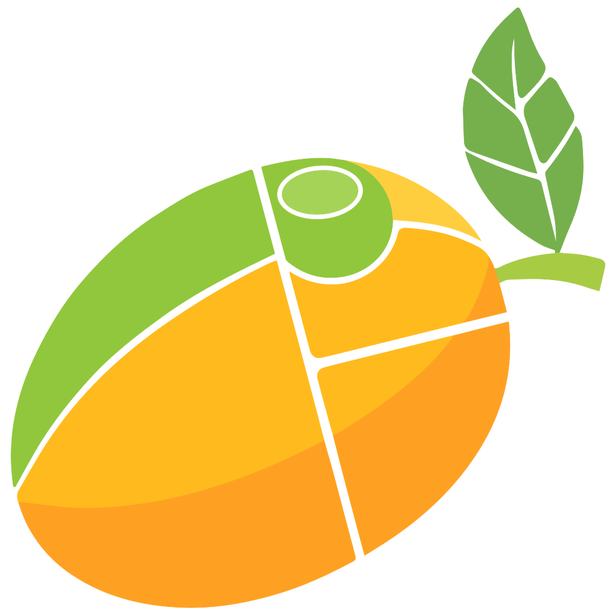

[Английский](README.md) | **Русский**

<div align="center">
  

  <h1>Mango Wayland Compositor v0.18.4</h1>

  <p>Быстрый, многофункциональный Wayland-композитор.</p>

</div>

---

https://github.com/user-attachments/assets/bb83004a-0563-4b48-ad89-6461a9b78b1f

https://github.com/user-attachments/assets/be85e13f-7798-456d-957e-f8931687392e

> **Порт для Termux/Android:** mango работает внутри Termux:X11 с аппаратными
> эффектами (blur, тени, скруглённые углы) через Android EGL + AHardwareBuffer.
> Инструкции по сборке и запуску — в разделе
> [Termux / Android](#termux--android) ниже.

> Все раскладки в действии: [mangowm.github.io](https://mangowm.github.io/)

> **Интеграция с Noctalia:** [English](TERMUX_NOCTALIA.md) | [Русский](TERMUX_NOCTALIA_ru.md)

---

## Termux / Android

Адаптация [mango](https://github.com/mangowm/mango) для Android/Termux.
Композитор работает как обычное приложение X11 внутри **Termux:X11**
(`termux-x11` + приложение `com.termux.x11`) и использует нативный бэкенд
wlroots `wlr_x11_backend`.

Termux:GUI больше не используется.

### Что изменено в исходниках

- `meson_options.txt` — опция `termux` (по умолчанию `true`).
- `meson.build` — в режиме `termux`:
  - не требуется `libinput` и `wlr/backend/session.h`;
  - подключаются заголовки-заглушки из `termux-compat/`;
  - линкуется `libandroid-wordexp` (в bionic нет `wordexp(3)`);
  - конфиги ставятся в `$PREFIX/etc/mango`.
- `termux-compat/libinput.h`, `termux-compat/wlr/backend/libinput.h`,
  `termux-compat/wlr/backend/session.h`,
  `termux-compat/wlr/types/wlr_drm_lease_v1.h` — заглушки отсутствующих в
  Termux-сборке wlroots интерфейсов.
- `src/main.c`:
  - выбор бэкенда `x11` (по умолчанию), `wayland`, `headless`;
  - в Termux по умолчанию используется `WLR_BACKENDS=x11`;
  - `mango_renderer_create()`: при наличии DRM/DMA-BUF (DRI3) берётся
    FX-рендерер scenefx; иначе в Termux пробует системный Android EGL +
    AHardwareBuffer (Adreno), а при неудаче — `pixman`.
- `src/manage/monitor.c` — пересоздание рендерера при GPU reset идёт через тот
  же `mango_renderer_create()` и `mango_allocator_create()`.
- `mangonag/mangonag.c` — `memfd_create` через `syscall()` для API < 30.
- `termux/ahb.c`, `termux/ahb.h` — AHardwareBuffer-аллокатор и буферы,
  системный Android EGL/GLES, EGLImage-провайдер для scenefx и отдача
  GPU-буфера в X11 через SHM. Так эффекты работают без DRI3.
- `termux/zink.c`, `termux/zink.h` — рендерер Mesa Zink + Turnip. Он рисует в
  те же AHardwareBuffer-ы, импортируя их как DMA-BUF EGLImage, поэтому эффекты
  идут через GPU Adreno открытым драйвером Freedreno Vulkan, а не через
  проприетарный Android EGL.
- `scenefx/` — исходники scenefx 0.5 с уже применённым
  Termux/AHardwareBuffer-патчем.
- `termux-compat/scenefx-termux.patch` — патч scenefx: pixman-fallback,
  поддержка внешнего EGLImage-провайдера (AHardwareBuffer), работа без
  `EGL_EXT_image_dma_buf_import` и `EGL_EXT_platform_base`.
- `build-termux.sh` — сборка встроенного scenefx с патчем + mango, а также
  приватные GPU-копии `mango`/`libwlroots`/`libscenefx` в
  `$PREFIX/lib/mango-termux`.
- `run-mango.sh` — запуск Termux:X11 (если не запущен) и mango в X11.
  Устанавливается в `$PREFIX/bin/mango-termux`.
- `termux/x11-check.c` — маленький пробник (`mango-x11-check`), который
  проверяет X11-соединение настоящим handshake, а не наличием файла сокета.

### Зависимости

```bash
pkg install clang pkg-config ninja patchelf git python-pip \
            wlroots libwayland libwayland-protocols libxkbcommon \
            libpixman libdrm libxcb xcb-util-wm xcb-util-renderutil \
            xwayland libglvnd-dev mesa mesa-dev \
            mesa-vulkan-icd-freedreno littlecms vulkan-loader \
            pcre2 pango cjson libandroid-wordexp
python -m pip install meson

# сервер Termux:X11
pkg install x11-repo
pkg update
pkg install termux-x11-nightly
```

### Пропатченный wlroots 0.20 (опционально)

Порт собирается против wlroots 0.20. Готовое дерево 0.20.2 с официальными
Termux-патчами (`shm_open`, пути Xwayland, backend Termux:GUI) лежит здесь:
<https://github.com/OceanSt0ne/wlroots-termux>. Установите его до сборки mango,
если нужны эти патчи или замена пакета Termux:

```bash
pkg install x11-repo
pkg install meson ninja clang pkg-config patch git \
  libwayland libwayland-protocols libdrm libxkbcommon libpixman \
  libglvnd-dev mesa-dev vulkan-loader-generic vulkan-headers glslang \
  libxcb xcb-util-renderutil xcb-util-wm xwayland littlecms termux-gui-c

git clone https://github.com/OceanSt0ne/wlroots-termux.git ~/Projects/wlroots-0.20
cd ~/Projects/wlroots-0.20
chmod 700 /data/data/com.termux/files/lib
meson setup build --prefix="$PREFIX" \
  -Dexamples=false -Dxwayland=enabled -Dsession=disabled \
  -Dbackends=x11,termuxgui -Drenderers=gles2,vulkan -Dwerror=false
ninja -C build
ninja -C build install
pkg-config --modversion wlroots-0.20   # 0.20.2
```

Termux-патчи уже в коммитах, применять их повторно не нужно. После установки
пересоберите mango через `./build-termux.sh`, чтобы обновилась приватная копия
`$PREFIX/lib/mango-termux/libwlroots-0.20.so`. Возврат к пакету Termux:
`pkg reinstall wlroots`.

`scenefx 0.5` встроен в `scenefx/` и собирается из исходников (см. ниже); в
репозиториях Termux его нет.

### Быстрый старт

Нужны Android arm64, Termux и приложение **Termux:X11**
(`com.termux.x11`).

```bash
pkg install clang pkg-config ninja patchelf git python-pip \
  wlroots libwayland libwayland-protocols libxkbcommon libpixman \
  libdrm libxcb xcb-util-wm xcb-util-renderutil xwayland \
  libglvnd-dev mesa mesa-dev mesa-vulkan-icd-freedreno \
  littlecms vulkan-loader pcre2 pango cjson libandroid-wordexp
python -m pip install meson

pkg install x11-repo
pkg update
pkg install termux-x11-nightly

# склонируйте ветку порта, например:
# git clone -b termux-port <URL> ~/Projects/mango-termux
cd ~/Projects/mango-termux
./build-termux.sh
mango-termux
```

Для нового конфига эффекты включаются автоматически; если конфиг уже
существовал, включите их вручную (см. раздел «Эффекты»). Запускайте именно
`mango-termux`: обычный `mango` остаётся pixman-путём.

### Сборка

Всё автоматизировано. Скрипт можно запускать из любого каталога — по
абсолютному пути, относительному пути или через симлинк:

```bash
cd ~/Projects/mango-termux
./build-termux.sh
```

Скрипт:

1. собирает встроенный scenefx 0.5 с уже применённым патчем из `scenefx/`
   (или из `$SCENEFX_DIR`);
2. собирает и устанавливает scenefx и mango в `$PREFIX`;
3. создаёт приватные GPU-копии в `$PREFIX/lib/mango-termux`, перенаправляя
   `libEGL`/`libGLESv2` на системные Android-библиотеки через `patchelf`;
4. копирует конфиг в `~/.config/mango` (для нового конфига сразу включает
   `blur`, тени и скругления).

Установленный `$PREFIX/bin/mango` — сборка Mesa/Turnip; приватный
`$PREFIX/lib/mango-termux/mango` — сборка Android EGL/AHardwareBuffer.

Если `scenefx` уже лежит в другом месте:

```bash
SCENEFX_DIR=/path/to/scenefx ./build-termux.sh
```

Если `$SCENEFX_DIR` указывает на git-дерево без патча, скрипт применит
`termux-compat/scenefx-termux.patch` автоматически.

Флаг `-Dtermux=true` уже используется скриптом. Ручная сборка ниже даёт
сборку Mesa/Turnip; для пути Android EGL/AHardwareBuffer дополнительно нужен
приватный бинарник из `./build-termux.sh`.

```bash
# scenefx (встроен, патч уже применён)
cd ~/Projects/mango-termux/scenefx
chmod 700 /data/data/com.termux/files/lib
meson setup build --prefix="$PREFIX" -Dexamples=false -Dwerror=false
meson compile -C build && meson install -C build
chmod 000 /data/data/com.termux/files/lib

# mango
cd ~/Projects/mango-termux
chmod 700 /data/data/com.termux/files/lib
meson setup build --prefix="$PREFIX" -Dtermux=true -Dxwayland=enabled
meson compile -C build && meson install -C build
chmod 000 /data/data/com.termux/files/lib
```

Проверка:

```bash
mango -v
mango -p -c ~/.config/mango/config.conf
```

### Запуск

Приложение **Termux:X11** (`com.termux.x11`) должно быть установлено. Пакет
`termux-x11-nightly` уже содержит сервер.

```bash
mango-termux
```

`mango-termux` — это установленная копия `run-mango.sh`, поэтому её можно
запускать из любого каталога и после любого перезапуска Termux.

Скрипт:

- выставляет `XDG_RUNTIME_DIR` (если не задан) в `$TMPDIR` и права `700`;
- использует `DISPLAY=:0` (переопределяется через `MANGO_X11_DISPLAY`);
- проверяет, что X-сервер на этом дисплее реально отвечает
  (`mango-x11-check`), а не просто существует файл сокета;
- если сервер не отвечает, стартует `termux-x11 "$DISPLAY" -ac -noreset`,
  ждёт соединения; при застарелом lock/socket убирает их и пробует ещё раз;
- выставляет `WLR_BACKENDS=x11`;
- выбирает рендерер: `MANGO_TERMUX_RENDERER=turnip` (по умолчанию) — Mesa
  Zink + Turnip, `ahb` — Android EGL/AHardwareBuffer, `pixman` — без GPU;
- даёт mango запустить Xwayland и передать дочерним процессам собственный
  `DISPLAY`, чтобы X11-приложения из mango оставались во вложенной сессии;
- запускает `$PREFIX/lib/mango-termux/mango` (GPU-эффекты), а если его нет —
  установленный `mango`, `./build/mango` или `$MANGO_BIN`.

Полезные варианты:

```bash
# подробный лог
mango-termux -d

# другой дисплей
MANGO_X11_DISPLAY=:1 mango-termux

# свой конфиг
mango-termux -c ~/.config/mango/config.conf

# стартовая команда
mango-termux -s foot

# перезапустить уже работающий mango
mango-termux --restart

# Android EGL/AHardwareBuffer вместо Turnip
MANGO_TERMUX_RENDERER=ahb mango-termux

# программный рендеринг (без GPU-эффектов)
MANGO_TERMUX_RENDERER=pixman mango-termux
```

### Повторный запуск после перезахода в Termux

Скрипт можно запускать повторно сколько угодно раз:

- если mango ещё работает (Termux не убил процесс), `mango-termux` найдёт его
  IPC-сокет `$XDG_RUNTIME_DIR/mango-*.sock`, проверит через `mmsg get version`
  и ничего не запустит повторно;
- если mango был убит, а wayland-сокеты остались, `mango-termux` удалит
  застарелые `wayland-*.lock`/сокеты (живой композитор держит `flock`);
- если Termux:X11 был убит и остался `.X0-lock`/сокет, скрипт проверит
  соединение, уберёт мёртвый lock и поднимет сервер заново;
- при необходимости принудительно заменить работающий экземпляр:
  `mango-termux --restart`.

#### Автозапуск при открытии Termux (необязательно)

Если нужно, чтобы mango поднимался сам при каждом новом интерактивном shell,
добавьте в конфиг shell проверку маркер-файла. Создайте маркер:

```bash
mkdir -p ~/.config/mango
touch ~/.config/mango/autostart
```

Для bash (`~/.bashrc`):

```bash
if [[ $- == *i* && -f "$HOME/.config/mango/autostart" ]]; then
  nohup mango-termux >/dev/null 2>&1 &
fi
```

Для fish (`~/.config/fish/config.fish`):

```fish
if status is-interactive; and test -f "$HOME/.config/mango/autostart"
    nohup mango-termux >/dev/null 2>&1 &
end
```

Убрать автозапуск: `rm ~/.config/mango/autostart`.

Если запускать `mango` напрямую, переменные нужно выставить самому:

```bash
export XDG_RUNTIME_DIR="$TMPDIR"
export DISPLAY=:0
export WLR_BACKENDS=x11
mango
```

### Конфигурация

Файлы ставятся в `$PREFIX/etc/mango/`. Mango ищет конфиг в порядке:

1. `~/.config/mango/config.conf`
2. `~/.config/mango/config.toml`
3. `$PREFIX/etc/mango/config.conf`
4. `$PREFIX/etc/mango/config.toml`

Горячие клавиши по умолчанию (`config.conf`):

| Комбинация | Действие |
|---|---|
| `Super+M` | выход из mango |
| `Alt+Return` | запустить `foot` |
| `Alt+Space` | `rofi -show drun` |
| `Super+R` | перечитать конфиг |
| `Alt+Q` | закрыть окно |
| `Super+Tab` | следующее окно |
| `Alt+Tab` | переключение jump-label |
| `Alt+F` | fullscreen |

`foot` и `rofi` нужно установить отдельно (`pkg install foot rofi`).

### Как это работает

`wlr_x11_backend` создаёт окно внутри X-сервера Termux:X11, принимает от него
клавиатуру, указатель и touch. Клиенты подключаются к mango по Wayland-сокету
(`$XDG_RUNTIME_DIR/wayland-0`):

```bash
export XDG_RUNTIME_DIR="$TMPDIR"
export WAYLAND_DISPLAY=wayland-0
foot
```

Рендеринг:

- при рабочем DRI3 (`wlr_backend_get_drm_fd() >= 0`) используется FX-рендерер
  scenefx;
- в Termux:X11 `DRI3Open` не отдаёт DRM-fd. По умолчанию `mango-termux`
  создаёт FX-рендерер scenefx на **Mesa Zink + Turnip** (Freedreno Vulkan) и
  рендерит в **AHardwareBuffer-ы**, импортируемые как DMA-BUF EGLImage.
  `MANGO_TERMUX_RENDERER=ahb` использует **системный Android EGL** (Adreno);
- буфер отдаётся X11-серверу через SHM с учётом выровненного stride;
- переменные Mesa/Vulkan действуют только на создание рендерера mango,
  поэтому дочерние GL-клиенты используют приватную Mesa 27 с нативным
  Freedreno/KGSL (`FD735`). С патченным Xwayland X11-клиенты получают DRI3 и
  тот же native KGSL вместо llvmpipe; см.
  [Xwayland на KGSL](#xwayland-на-kgsl). Noctalia внутри Arch-proot использует
  Mesa 27 с нативным Freedreno/KGSL (`renderer="FD735"`) по умолчанию; см.
  [руководство по Noctalia](TERMUX_NOCTALIA_ru.md). `NOCTALIA_GPU=0` оставляет
  запасной llvmpipe.
- AHB/offscreen-буферы сэмплируются через их EGLImage/DMA-BUF, а не через
  CPU-копию, поэтому blur в scenefx читает уже отрисованную GPU сцену.
  Оптимизированный blur обновляется при повреждении области blur, так что
  чёрный или устаревший фон не появляется без полной перерисовки каждого кадра;
- если GPU-рендеринг недоступен, автоматически включается `pixman` и scenefx
  рисует сцену без эффектов.

### Эффекты

Эффекты включаются в `~/.config/mango/config.conf` (или `config.toml`):

```ini
blur=1
blur_layer=1
shadows=1
layer_shadows=1
border_radius=12
```

При запуске через `mango-termux` они работают на GPU (blur, тени, скруглённые
углы, анимации). Проверить, что выбран путь Turnip:

```bash
MANGO_TERMUX_RENDERER=turnip mango-termux --restart -d 2>&1 | \
  grep -E 'Zink|Turnip|AHB|FX renderer|pixman'
```

Чтобы использовать путь Android EGL/AHardwareBuffer:

```bash
MANGO_TERMUX_RENDERER=ahb mango-termux
```

Принудительно вернуться к pixman (без эффектов, для диагностики):

```bash
MANGO_TERMUX_RENDERER=pixman mango-termux
```

Прямой запуск `$PREFIX/bin/mango` не выставляет окружение рендерера;
используйте `mango-termux` или явно задайте
`MANGO_TERMUX_RENDERER=turnip`.

### Ограничения

- В Termux нет DRM/libinput/session-бэкендов — так собран `wlroots-0.20`.
- Termux:X11 не отдаёт DRI3 DRM-fd. Эффекты работают через AHardwareBuffer и
  либо Mesa Zink + Turnip, либо системный Android EGL. Путь AHB требует
  рабочего `/system/lib64/libEGL.so`; путь Turnip — пакета
  `mesa-vulkan-icd-freedreno`. Иначе используется pixman.
- Turnip/Zink добавляет слой трансляции в Vulkan; на некоторых нагрузках путь
  Android EGL/AHardwareBuffer может быть быстрее.
- На очень больших разрешениях копирование AHB в SHM для X11 может быть
  узким местом.
- XWayland включён. X11-приложения, запущенные из mango, используют его
  вложенный Xwayland-дисплей и управляются композитором; приложения из shell с
  внешним `DISPLAY` (`:0`) по-прежнему открываются прямо в Termux:X11.
- `chvt`/переключение виртуальных терминалов недоступно.

### Xwayland на KGSL

Штатный Xwayland в Termux собран с `-Dglamor=false`, поэтому X11-клиенты
внутри mango не имеют DRI3/GLX и используют llvmpipe. `run-mango.sh`
автоматически берёт патченный сервер из
`$PREFIX/opt/xwayland-kgsl/bin/Xwayland`, если он установлен:

- glamor/DRI3 включаются на `/dev/kgsl-3d0` без `/dev/dri` и `wl_drm`;
- обёртка запускает сервер Xwayland с приватной Mesa 27 из
  `$PREFIX/opt/mesa-kgsl` (`MESA_LOADER_DRIVER_OVERRIDE=zink`,
  `GALLIUM_DRIVER=zink`, `FD_KGSL_DMABUF=1`);
- X11-клиенты наследуют нативный путь Mesa 27 из сессии
  (`MESA_LOADER_DRIVER_OVERRIDE=kgsl`, `GALLIUM_DRIVER=kgsl`) и рендерят
  напрямую через Freedreno/KGSL; глобальный Zink специально не экспортируется,
  потому что с ним некорректно работает GTK4/Ghostty;
- линейные KGSL-буферы экспортируются как `DRM_FORMAT_MOD_LINEAR`, поэтому
  композитор импортирует их, а не показывает чёрные окна.

Проверка из терминала внутри mango:

```sh
DISPLAY=:1 glxinfo -B | grep -E 'Accelerated|OpenGL renderer'
# Accelerated: yes
# OpenGL renderer string: FD735
```

Для одноразовой диагностики через Zink/Turnip:

```sh
MESA_LOADER_DRIVER_OVERRIDE=zink GALLIUM_DRIVER=zink glxinfo -B
# OpenGL renderer string: zink Vulkan 1.4(Turnip Adreno (TM) 735 ...)
```

Путь можно переопределить через `WLR_XWAYLAND=/path/to/Xwayland`.

### Диагностика

- `Failed to open DRI3` / `Disabling DMA-BUF support` — нормально для
  Termux:X11. `mango-termux` не использует DRI3: эффекты идут через
  системный Android EGL + AHardwareBuffer.
- `OpenGL renderer string: FD735` — для сессии и X11-клиентов активен
  нативный Freedreno/KGSL.
- `OpenGL renderer string: zink Vulkan ... Turnip ...` — активен Zink/Turnip;
  это ожидаемо для рендерера самого mango или при явном запросе для
  диагностической команды.
- `Termux: Zink/Turnip renderer unavailable` — проверьте Freedreno ICD:
  `VK_ICD_FILENAMES=$PREFIX/share/vulkan/icd.d/freedreno_icd.aarch64.json vulkaninfo --summary`
  и наличие пакета `mesa-vulkan-icd-freedreno`. После этого mango перейдёт на
  AHB или pixman.
- `Termux: AHB/EGL renderer unavailable, falling back to pixman` — не найден
  системный EGL/AHardwareBuffer или приватные библиотеки. Пересоберите
  `./build-termux.sh` (нужен `patchelf`) и запускайте `mango-termux`.
- `fatal error: 'gbm.h' file not found` — пакет Termux `mesa` даёт
  `gbm.pc`/`libgbm`, а сам заголовок лежит в `mesa-dev`. Установите его и
  перезапустите сборку: `pkg install mesa-dev && ./build-termux.sh`. Удалять
  каталог сборки не нужно — упавшая цель пересоберётся.
- `X11 error: op 18:0, code 5` — безвредные ошибки `ChangeProperty` при
  старте X11-бэкенда.
- `Failed to connect to Termux:X11` — проверьте лог
  `$TMPDIR/termux-x11.log`, запустите приложение Termux:X11 вручную и
  проверьте соединение: `DISPLAY=:0 mango-x11-check; echo $?`.
- X11-приложения открываются на внешнем рабочем столе Termux:X11, а не внутри
  mango — они унаследовали внешний `DISPLAY` (`:0`). Запускайте их из терминала,
  открытого внутри mango (он экспортирует вложенный Xwayland-дисплей), или через
  `mango-termux -s <app>`. Пересоберите текущим `./build-termux.sh`: он включает
  Xwayland и для уже существующего каталога сборки.
- Чёрный/пустой экран — убедитесь, что открыто приложение Termux:X11;
  запускайте через `run-mango.sh -d` и смотрите лог.
- Медленно — уменьшите разрешение экрана Termux:X11 или отключите анимации
  в `config.conf`.
- `couldn't create renderer` — проверьте, что scenefx собран с патчем
  `scenefx-termux.patch` и установлен в `$PREFIX`, а `mango-termux`
  использует `$PREFIX/lib/mango-termux/mango`.

### Пересборка

```bash
cd ~/Projects/mango-termux
./build-termux.sh
```
